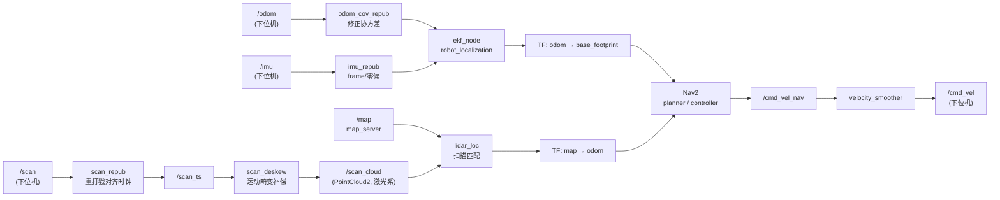

# roscar_nav_last

基于 **ROS 2 Humble** 的差速小车 SLAM / 定位 / 导航工作空间。

下位机（STM32 + 转镜激光雷达）通过 micro-ROS 发布 `/scan`、`/odom`、`/imu`，
上位机负责 **TF 融合 → 建图 → 定位 → Nav2 导航**。

---

## 1. 功能包一览

| 功能包 | 作用 | 启动入口 |
|---|---|---|
| `xcar_description` | URDF 模型 + RViz 显示 | `ros2 launch xcar_description display.launch.py` |
| `xcar_bringup` | 本体启动：URDF→静态 TF、EKF 融合、雷达时间戳/去畸变 | `ros2 launch xcar_bringup robot_base.launch.py` |
| `slam_pkg` | slam_toolbox 建图 | `ros2 launch slam_pkg slam_robot.launch.py` |
| `xcar_jiguang` | 纯激光地图匹配定位（**替代 AMCL**，发布 `map -> odom`） | `ros2 launch xcar_jiguang lidar_loc.launch.py` |
| `xcar_nav` | Nav2 导航（静态地图 + 定位 + 规划控制） | `ros2 launch xcar_nav navigation.launch.py` |

依赖关系：

```
xcar_nav ──→ xcar_jiguang / xcar_bringup / xcar_description
slam_pkg ──→ xcar_bringup / xcar_description
```

各包详细说明见 `src/<包名>/README.md`。

---

## 2. 环境依赖

- Ubuntu 22.04 + ROS 2 Humble
- 系统 Python **3.10**（Humble 的 `rclpy` 不认 conda 的 python，脚本已写死 `/usr/bin/python3`）

```bash
sudo apt install ros-humble-navigation2 ros-humble-nav2-bringup \
                 ros-humble-slam-toolbox ros-humble-robot-localization \
                 ros-humble-tf2-tools libopencv-dev
```

下位机连接（另起终端）：

```bash
docker run -it --rm -v /dev:/dev -v /dev/shm:/dev/shm --privileged --net=host \
  registry.cn-hangzhou.aliyuncs.com/fishros/micro-ros-agent:$ROS_DISTRO \
  udp4 --port 8888 -v6
```

启动后确认数据：

```bash
ros2 topic hz /scan     # ≈5 Hz（转镜雷达一圈 200 ms）
ros2 topic hz /odom
ros2 topic hz /imu
```

---

## 3. 编译

```bash
cd ~/roscar_nav_last
source /opt/ros/humble/setup.bash
colcon build --symlink-install
source install/setup.bash
```

只改某个包时：`colcon build --packages-select <包名>`。
（`build/`、`install/`、`log/` 是编译产物，不需要提交。）

---

## 4. 常用流程

### 4.1 建图

```bash
ros2 launch slam_pkg slam_robot.launch.py          # 加 use_rviz:=true 开 RViz
ros2 run teleop_twist_keyboard teleop_twist_keyboard   # 另开终端遥控跑一圈
```

跑完存图（直接存进 `xcar_nav/maps/`）：

```bash
ros2 run nav2_map_server map_saver_cli -f src/xcar_nav/maps/新地图名
colcon build --packages-select xcar_nav
```

### 4.2 导航

```bash
ros2 launch xcar_nav navigation.launch.py                       # 默认地图 maps/shiyan.yaml
ros2 launch xcar_nav navigation.launch.py map:=$PWD/src/xcar_nav/maps/qinshi.yaml use_rviz:=true
```

RViz 里：先 **2D Pose Estimate** 给初值 → 再 **2D Goal Pose** 下目标。

命令行直接下发目标点（不用 RViz）：

```bash
ros2 action send_goal /navigate_to_pose nav2_msgs/action/NavigateToPose \
  "{pose: {header: {frame_id: map}, pose: {position: {x: 0.5, y: 0.0, z: 0.0}, orientation: {w: 1.0}}}}"
```

> ⚠️ 建图与导航**不能同时运行**：`map -> odom` 会分别由 slam_toolbox 与
> `lidar_loc` 发布，互相抢发。

---

## 5. 数据流与 TF 权责



| TF 段 | 唯一发布者 | 说明 |
|---|---|---|
| `base_footprint → base_link → 雷达/IMU/轮子` | `robot_state_publisher`（`xcar.urdf`） | 全部 fixed joint，无关节状态发布器 |
| `odom → base_footprint` | `ekf_node`（默认）或 `odom2tf`（`use_ekf:=false`） | **只能有一个**发布者 |
| `map → odom` | 建图时 slam_toolbox；导航时 `lidar_loc` | 二者不可同时运行 |

关键话题：

| 话题 | 类型 | 发布者 |
|---|---|---|
| `/scan` / `/scan_ts` | `LaserScan` | 下位机 / `scan_repub` |
| `/scan_cloud` | `PointCloud2` | `scan_deskew`（去畸变，激光系） |
| `/odom` / `/odom_cov` / `/odom/filtered` | `Odometry` | 下位机 / `odom_cov_repub` / `ekf_node` |
| `/imu_rotated` | `Imu` | `imu_repub` |
| `/amcl_pose` | `PoseWithCovarianceStamped` | `lidar_loc`（沿用 AMCL 话题名） |
| `/cmd_vel` | `Twist` | `velocity_smoother` → 下位机 |

---

## 6. 目录结构

```
roscar_nav_last/
├── README.md                 本文件
├── 指令.txt                   常用命令速查
├── src/
│   ├── xcar_description/     URDF + RViz
│   ├── xcar_bringup/         本体启动（TF / EKF / 雷达预处理）
│   ├── slam_pkg/             建图
│   ├── xcar_jiguang/         纯激光定位
│   └── xcar_nav/             Nav2 导航 + 地图
├── tools/                    离线验证 / 实车诊断脚本（见 tools/README.md）
├── build/ install/ log/      编译产物
```

---

## 7. 约定与坑

1. **TF 不能抢发**：`odom -> base_footprint` 只由 EKF（或 `odom2tf`）发布；
   `map -> odom` 只由 slam_toolbox（建图）或 `lidar_loc`（导航）发布。
2. **下位机时钟比上位机旧 0.4~0.7 s**，所以 `scan_repub` / `odom2tf` 会按接收时刻重打戳；
   `scan_repub` 还会减去 `scan_time/2` 把时间戳对齐到扫描中点。
3. **转镜雷达有运动畸变**：一圈 200 ms 内车位姿在变，单一时间戳会把整圈"糊"开，
   必须用 `scan_deskew` 输出的 `/scan_cloud`（保持在激光系，否则射线清除会错）。
4. **轮子里程计 yaw 不可信**（实测方向反 + 比例约 48%），EKF 的 `odom0_config`
   已把 yaw 关闭，航向靠 IMU 陀螺积分 + 激光匹配兜底。详见 `xcar_bringup/README.md`。
5. **Python 节点必须用 `#!/usr/bin/python3`**，且新增脚本要加进
   `CMakeLists.txt` 的 `install(PROGRAMS)`，否则 `ros2 run` 找不到。
6. 改了 RViz 配置要**重启 RViz** 才生效。

---

## 8. 排障速查

| 现象 | 先查什么 |
|---|---|
| RViz 里点云和地图对不上、整体滞后 | `ros2 run tf2_ros tf2_monitor map base_link` 看 Delay；确认 `/scan_ts` 有数据 |
| 旋转时局部代价地图糊成一片 | `ros2 topic hz /scan_cloud` 是否 ≈5 Hz（`scan_deskew` 是否在跑） |
| 定位不动 / 位姿乱跳 | `lidar_loc` 日志里的"质量"是否 >0.9；是否点过 2D Pose Estimate |
| 车不动但 RViz 有路径 | `ros2 topic echo /cmd_vel`；确认下位机订阅同一话题 |
| 局部代价地图"脏块" | 多为被墙遮挡区域的历史标记（Nav2 固有行为），停车 3 s 会自动清理 |

更多诊断脚本与用法：`tools/README.md`。
